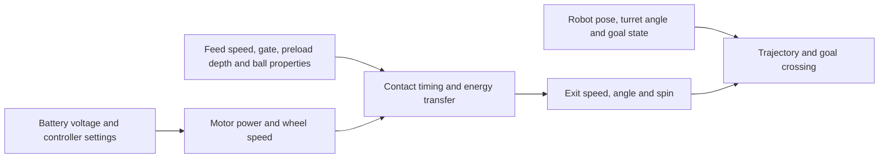

# Pickles shooting: model, test plan, video setup and logging audit

Prepared 2026-11-08 against the current working tree. This is a model to identify
causes and design tests, not a fitted prediction of this robot's shots. No new
robot trial data was supplied. Geometry, ball properties, wheel inertia and
launch coupling still need measurement. The wheel/weight dimensions supplied
later in this conversation are incorporated below. The companion `shooting_model_2026.py`
runs offline; it does not alter the robot's shooting behavior.

## What to do first

1. Capture an unchanged baseline, including the opening autonomous volley on a
   fresh battery. Record **every ball**, not just whether the volley mostly scored.
2. At the same fixed location/RPM/loading method, compare boost enabled versus
   disabled on fresh and partly used batteries. Do not also change RPM or gains.
3. Use video to distinguish high wheel RPM from changed launch speed/angle at
   similar RPM. Then test loading depth, feed behavior or controller tuning as
   indicated by the evidence.
4. Test the added inertia as a separate hardware change. If the turret must be
   installed at the same time, call that a new hardware baseline and avoid
   attributing the entire difference to inertia. Initially lock the turret at a
   repeatable angle and keep the chassis still.
5. Refit RPM versus distance only after repeatability is acceptable. Test both
   hive sides and reserve separate runs to validate the fit.

Because most/all of the first volley went long, a shared condition such as wheel
speed, boost, goal geometry or feeding is a stronger initial hypothesis than an
effect confined to the first ball. Preload depth could still change the timing
of the entire stack, so it remains worth testing. None of these is yet proven.

## Supplied hardware and CAD: what can now be calculated

The hardware profile is saved in `shooting_hardware_2026.json`. Confirmed user
inputs are a 72 mm wheel and three added weights, each 0.166 lb, 33 mm inside
diameter, 55.5 mm outside diameter and 0.25 in axial width. The proposed comparison
is a fourth identical weight. The [goBILDA wheel page](https://www.gobilda.com/3601-series-rhino-wheel-14mm-bore-72mm-diameter/)
confirms the 72 mm diameter and lists 85 g mass with a plastic body/rubber tread.
Its rotational mass distribution is not supplied, so its exact inertia is unknown.

Treating each added weight as a uniform concentric annulus:

```
mass = 0.166 * 0.45359237 = 0.0752963 kg
J_each = 0.5 * mass * (0.0165^2 + 0.02775^2)
       = 0.0000392412 kg m^2
```

| Quantity | Three weights | Four weights |
| --- | ---: | ---: |
| Added mass | 225.9 g | 301.2 g |
| Added rotational inertia | 0.000117723 kg m² | 0.000156965 kg m² |
| Energy in weights at 2950 RPM | 5.62 J | 7.49 J |
| Energy in weights at 3150 RPM | 6.40 J | 8.54 J |

The fourth weight adds about 2.13 J at 3150 RPM and 33.3% to the **weights'
contribution**. The percentage increase in the complete rotating assembly is
smaller because the wheel, shaft, hubs and motor already contribute inertia.
The weights' axial width does not independently enter this formula once mass
and radii are known; axial placement still matters mechanically. Holes or
nonuniform mass distribution make the annulus result approximate.

The 72 mm wheel's uncompressed rim speed is 11.12 m/s at 2950 RPM and 11.88 m/s
at 3150 RPM. These are not ball exit speeds. Video must establish the coupling
and how it varies during compression/contact. Changing 2950 to 3150 increases
rim speed by 6.78% and stored energy at the same inertia by about 14.0%.

The user confirmed that the dashed Ø71.12 circle is the nominal ball, that
typical team measurements are nearer 72 mm, and that 280 mm is the **shaft-center
height**. The actual guide radius is about 106 mm from the wheel axis. The ball
leaves the front guide surface at the edge of the 11.5° line inside the gray box.

For the concentric guide, uncompressed radial clearance is `106 - 36 = 70 mm`:

| Ball diameter | Geometric interference with 70 mm gap |
| --- | ---: |
| Nominal 71.12 mm | 1.12 mm |
| Typical reported 72.00 mm | 2.00 mm |

This is combined wheel/ball interference, not necessarily ball deformation alone.
Rubber compliance, ball compliance, diameter variation and guide flex determine
the actual contact force and contact length. The extra 0.88 mm can matter for
repeatability; it does not imply a proportional increase in launch energy.
Measure the actual test balls in multiple orientations using a consistent light
measurement force, label them, and rotate their shot order in repeated volleys.

**Provisional geometric estimate:** interpreting the indicated guide edge near
the CAD's 20.4 mm level and the shaft at 48 mm above the same base gives a guide
edge 27.6 mm below the shaft. For a 106 mm circular guide and upward travel on
the left of the wheel:

```
guide tangent elevation = acos(27.6 / 106) = about 74.9 degrees
ball-center radius from shaft, using a 72 mm undeformed ball = 106 - 36 = 70 mm
ball-center height at guide edge = 280 - 27.6*(70/106) = about 261.8 mm
```

The 11.5° line marks an inclined cut/edge in this interpretation; its angle is
not automatically the trajectory angle or its complement. The actual edge's
intersection with that inclined line can differ from the 20.4 mm level. These
numbers therefore remain separately labeled CAD estimates in the model, while
the calibrated `exit_height_m` and `exit_elevation_deg` remain unset.

To refine the geometry, obtain the coordinates of the actual guide endpoint
relative to the wheel axis in a section normal to the shaft, with the base
referenced to field horizontal. The ball-center path tangent there is a useful
initial estimate. Compression recovery and continued wheel contact after losing
guide contact can change the final free-flight velocity, so verify roughly
75°/262 mm using the side video instead of deploying them as calibrated values.

For the next mass experiment, keep a three-weight baseline if practical, then
fit the fourth weight and repeat at the same RPM/feed/boost setting. Do not
retune RPM and add mass in the same comparison. Record the guide and turret
mounting version too, since the forthcoming turret could change exit geometry.

## 1. A model with four measurable layers



### A. Controller and electrical input: already observable

For a normal enabled update, the current Java controller is approximately:

```
e = targetRPM - measuredRPM
g = clamp(12.5 / filteredBatteryVoltage, 1.00, 1.05)
u_control = clamp(kP*e + kI*integral + kD*errorDerivative
                  + g*(kS + kV*targetRPM + kA*targetAcceleration), 0, 1)
u_requested = max(u_control, boostFloor)   # only during boost
u_applied = slew(u_requested)             # bypassed during boost by default
motorVoltage_estimate = u_applied * rawBatteryVoltage
```

Source snapshot: kP=0.0009, kI=kD=0, kS=0.09, kV=0.000134, kA=0;
normal slew=1.5 power/second. Boost starts 0.18 s after the feed command,
lasts 0.50 s, has a 0.75 floor and bypasses slew; feed duration is 1.2 s.
Verify actual run CONFIG records because Panels can override these values.

At exactly target RPM, before slew, the source defaults give:

| Target | Controller power at compensation gain 1 | Boost floor | Floor's added power at that instant |
| --- | ---: | ---: | ---: |
| 2950 RPM | 0.4853 | 0.7500 | 0.2647 |
| 3150 RPM | 0.5121 | 0.7500 | 0.2379 |

At 100 RPM above a 2950 target, proportional feedback reduces the request to
0.3953, but active boost still forces at least 0.75 before slew. Conversely,
when the controller already requests more than 0.75, that floor adds nothing.
The floor is **not an additive 75% boost**, nor is it scaled by the compensation
gain. At 14 V versus 12.5 V, a 0.75 duty command corresponds approximately to
10.50 V versus 9.375 V average motor input. These are electrical estimates,
not predicted RPM or ball range; losses and motor back-EMF matter.

Yes, the current minimum compensation gain of 1 prevents feedforward reduction
above nominal voltage. Feedback can still reduce output. Therefore this setting
alone does not establish that fresh batteries cause overshoot. The timed floor
can prevent that feedback reduction while active. Normal slew can also delay
power reduction after the floor ends. Compare the logged stages of the output.

The code's `kA` multiplies **target acceleration**, not measured RPM deceleration.
With a constant RPM target it is zero during ball contact; increasing it alone
would not create a contact-recovery boost.

### B. Wheel dynamics: fit from no-ball tests, then validate under load

Use an empirical motor model with voltage as input:

```
d(omega)/dt = a * (u_applied * Vbus) - b * omega - c - tau_ball / J
omega = RPM * 2*pi/60
wheel energy = 0.5 * J * omega^2
```

Here a, b and c are fitted coefficients for positive rotation; J is equivalent
rotational inertia at the flywheel, and tau_ball is load torque during contact.
This reduced model omits current limits, temperature effects and nonlinear
friction. Fit only away from contacts, near the intended operating range.
Do not reuse the software's duty/RPM feedforward numbers as voltage/radian plant
coefficients without converting units and identifying their meaning.

Collect no-ball spin-up/target-step/coast-down traces at more than one battery
condition. Fit time-domain RPM responses using actual logged time intervals;
finite differences of a 28-count/revolution encoder can be noisy. Compare the
SDK RPM and encoder-delta RPM. A coast-down trace uses FLOAT in this subsystem.
Reserve another trace for validation. A fitted model should predict that trace's
rise time and steady speed before using it to compare hypothetical controls.

#### November 22 calibration choices

For opening-volley spinup, select **November 22 startup and coast**. The fit
uses a constant drag torque plus a term proportional to speed. One unloaded
recording supplies coast drag and two additional Quick Screen recordings supply
powered starts. Separate recordings supply the checks below.

| Held-out check | November 19 fit | November 22 startup fit |
| --- | ---: | ---: |
| Startup replay, median trial RMS error across 21 starts | 49.5 RPM | 41.8 RPM |
| First 600 ms of feed, median trial RMS error across 34 volleys | 67.2 RPM | 74.7 RPM |
| Median absolute error in readiness time, 11 candidate cold starts at 3196 RPM | 15 ms | 16 ms |

The first two checks replay measured bus voltage and motor commands. The
readiness check computes motor commands in closed loop using the recorded
voltage and the typical loop period of each trial. Readiness is the end of the
first continuous 150 ms within 75 RPM of the final target on sampled encoder
feedback. The estimate is separate from the scheduled feed time. Both fits
predicted readiness to within about one loop on a typical trial at this RPM.
The November 22 coast prediction still ran 1.2 to 1.9 s longer than observed
across the three held-out coasts to 500 RPM.

For boost and feed comparisons, select **November 19 loaded volleys**. Fitting
a single shift, stretch and strength adjustment to the four load pulses raised
held-out volley error to 76.1 RPM. The published load stays at the league fit.
Use the fourth-pulse offset to see whether a boost choice is sensitive to a
shorter third-to-fourth gap. The offset represents assumed loading at the wheel.
Video at the hive includes differences in flight time and possible collisions.

For the next opener, use the expected scoring RPM at the actual pose. The
3100 RPM example below is a trial setting. Log bus voltage during acceleration
and record feed to fourth exit and the four-ball spread at the hive. Those
observations check both the timing prediction and the scoring result.

```sh
python scripts/flywheel_dynamics_2026.py --calibration startup --tested-startup --target 3100 --voltage 12.5
python scripts/refine_flywheel_plant_2026.py path/to/ShotTuning/LogData
```

For a very brief contact, the wheel's observed energy change is
`0.5*J*(omega_before^2 - omega_after^2)`. Motor work during contact, friction,
ball spin and ball deformation mean this is **not** equal to just `0.5*m*v^2`.
Use it first as a repeatability metric, not a ball-speed sensor.

For the same initial speed and the same assumed energy draw, doubling inertia
reduces RPM droop. It also takes more torque/time to accelerate that inertia.
Mass at larger radius contributes more: a thin ring adds about `m*r^2`, while a
uniform disk adds `0.5*m*r^2`. Record the added mass **and its radial location**.
Do not equate a 20% mass increase with a 20% inertia increase.

This structure follows the voltage-input flywheel modeling approach described
in [WPILib's flywheel modeling guide](https://docs.wpilib.org/en/stable/docs/software/advanced-controls/state-space/state-space-flywheel-walkthrough.html).
It does not require WPILib, SysId or a Pedro upgrade on this FTC robot.

### C. Feed/contact: RPM is only one input to ball speed

Start with `v_exit = coupling * (pi * wheelDiameter * RPM_contact / 60)`.
Estimate coupling from synchronized video at several speeds. It absorbs wheel
compression, slip and the opposing surface/roller geometry. Do not assume ball
speed equals wheel rim speed. Ball spin, compression and feed velocity can all
change the relationship. If coupling changes systematically with feed speed or
preload depth, a single coefficient is not sufficient.

Distinguish these events for each ball:

| Event | How to observe it |
| --- | --- |
| Feed commanded | Sequence start timestamp / feeding request |
| Gate physically begins opening | Close-up video; servo command is not physical position |
| First wheel contact | Visible contact/deformation, if unobstructed; otherwise mark unknown |
| Ball leaves final contact | Close-up video; use a defined exit plane consistently |
| Ball crosses the goal reference plane | Side and rear videos |
| Goal hit/miss and hive state | Wide view/manual annotation |

Measure contact delay from the feed command, separation between ball exits,
wheel RPM just before contact, minimum RPM during that contact and recovery
before the next contact. A beam transition or RPM dip is supporting evidence,
not an automatic ball ID. Balls may have holes, vibrate, touch each other, or
produce overlapping RPM dips. Mark obscured events unknown.

### D. Flight and aim: geometry first, then empirical corrections

For a stationary shot with fixed elevation theta and exit height h:

```
x(t) = v_exit*cos(theta)*t
z(t) = h + v_exit*sin(theta)*t - 0.5*g*t^2
time at goal plane = distance / (v_exit*cos(theta))
```

Here x is along the shot, not necessarily field +X. Field +X is right and +Y is
up-field. Use metres/seconds in calculations. Measure horizontal distance from
the **ball exit**, not the robot center. Transform the exit offset using chassis
and turret angles. The existing regression uses its configured Pedro pose/goal
reference; keep that convention consistent when fitting the regression, even
though the physical model uses exit-to-goal geometry.

With yaw error psi, use horizontal components `v*cos(theta)*cos(psi)` and
`v*cos(theta)*sin(psi)`. For small yaw errors, lateral displacement is about
`distance*psi` with psi in radians. Record chassis pitch/roll effects through
video because the current log contains planar heading, not shooter elevation.

Compare the ball's center, radius and velocity at the actual receiving opening
and its current tilt. Simply reaching a goal-center point is not a scoring
guarantee. Record whether the ball is rising or falling at the opening. A ball
that clears the front edge but strikes the back edge is different from one that
never reaches the opening. There is no camera-based hive-state measurement yet.

The ideal equations omit drag, lift from spin, ball deformation and bounces.
Use them to separate angle/speed/position sensitivity; use video-derived flight
and held-out scoring trials for prediction. At equal launch/landing heights,
ideal range scales with speed squared: 2% faster gives about 4% more range at
fixed angle. That example is **not** a quantitative prediction for the elevated
and tilting hive.

For later shooting on the move, add chassis translational velocity and the
rotational velocity of the exit about the robot/turret pivot to the launch
velocity. Do that after stationary repeatability is established.

## 2. Practical test sequence

For the first 30-minute session, follow the [stationary experiment guide](Shot_Experiments_2026.md#first-30-minutes).
The phases below describe follow-up work for later sessions.

### Before collecting data

- Preserve one baseline build/configuration and photograph the mechanism.
- Set `BUILD_LABEL` to the revision plus a working-tree tag if modified;
  `PROFILE_LABEL` to the test condition; `RUN_NOTES` to battery label, hardware
  version, ball IDs, loading method and video filenames. Snapshot the actual
  Panels settings. Keep settings fixed within a trial.
- Measure wheel diameter, exit height/elevation, pivot/exit offsets, ball mass
  and diameter, compression gap and added mass/radius. Note rubber wear and
  warm/cold mechanism state. A photo and measured preload reference are useful.
- Mark robot wheel positions and heading on the floor. Set the hive to the same
  receiving state and starting contents before each equivalent test. Do not
  compare a receptive hive to a transitioning/downward hive as a shooter miss.
- Use the same ball set initially and record their order. Rotate ball order in
  later blocks to separate an individual ball effect from shot number.
- Keep match and detail logging on, detail interval 0, memory mode, early
  post-shot writes off. Keep initial trials below 35/125 s, or disable long-
  practice writes if memory usage has been checked for the planned duration.
- Make one short trial and verify video, logs, sensor ages, sample intervals,
  drop counters and downloaded files before the main experiment.

### Phase 0: establish measurement overhead and no-ball behavior

Run the same spin-up and short target-change sequence with detailed logging on
and off, with at least three repeats each. Compare median/p95/max loop period
and shooter period, not only average capture time. Exclude initialization/Stop
from steady-loop comparisons but inspect first-shot timing separately.
Check for repeated sample values/ages and dropped rows. This verifies the
measurement system before interpreting subtle contact timing.

No-ball trials at the actual close and far targets establish steady error,
spin-up, overshoot and whether voltage dependence exists even without feeding.
Use the Flywheel Model opmode's timed preparation and hold intervals. Separately
preserve the real immediate-start autonomous timing for opening-volley tests;
a long laboratory spin-up would hide the problem you are investigating.

### Phase 1: opening-volley battery x boost screen

Use the actual opening pose, the expected scoring RPM for that pose, unchanged
feed settings and a repeatable preload depth. Hold that RPM constant when
comparing startup controllers. Reserve the November 22 reference of 3196 RPM
for model comparisons. The old 2950 RPM command exploited startup overshoot and slow decay.
Use the recorded wheel RPM from those meet openers as the historical baseline.
Once the new controller regulates consistently, bracket the scoring RPM at the fixed shooting pose.

| Condition | Battery condition | Boost | Initial repeats |
| --- | --- | --- | ---: |
| A | Fresh/charged | Current settings | 5 volleys |
| B | Fresh/charged | Disabled | 5 volleys |
| C | Representative partly used | Current settings | 5 volleys |
| D | Representative partly used | Disabled | 5 volleys |

Five volleys per condition is an initial screen, not proof of reliability.
For four-ball loads that is 80 balls, but balls within one volley share battery,
temperature and loading conditions; they are not 80 independent experiments.
Analyze by volley as well as ball position. Retest promising conditions with
at least ten volleys across another session and more than one battery pack.

Alternate boost settings within battery-condition blocks (ABBA/BAAB order),
rotate which pack/setting goes first, and reset/recharge as necessary. Do not
shoot all boosted trials first and all unboosted trials after the pack warms or
discharges. Record prefeed and loaded voltage; elapsed practice minutes or an
unloaded voltage alone do not define battery condition. Battery labels are
experimental IDs, not device serial numbers.

Repeat the selected comparison under the actual CloseShootingAlone opening
sequence, including its immediate spin-up, not just stationary teleop. Later
run the far-target condition: the same fixed boost floor can have a different
effect when the normal required power is different.

### Phase 2: isolate preload and feed timing

With the selected fixed controller setting, compare two **measured, repeatable**
loading depths within the mechanism's normal usable range. Start with a single
ball to see contact and exit clearly, then repeat with full volleys. Do not
compare a single-ball trial directly with a full stack as if depth were the
only change. Five repeats of each depth and load size is a useful first pass.

If depth changes feed-to-contact timing but not exit speed at the same contact
RPM, investigate boost alignment. If speed/angle changes at similar RPM,
investigate compression, guide alignment, feed acceleration and ball condition.
Only then vary feed speed/power, one factor at a time. In velocity mode, a power
setting may not be the active command; use the logged applied control mode.

### Phase 3: added inertia and turret installation

Compare old/new inertia at the same RPM and feed condition with boost disabled
first. Use matched battery blocks. Measure droop, recovery before each next ball,
spin-up time and per-ball outcomes. Then add the least boost supported by the
data if needed. Do not retain the old boost automatically after increasing inertia.

If RPM control needs tuning, establish feedforward/no-load steady behavior first,
then proportional response and recovery, and only add other terms for an
observed problem. Consider compensation below gain 1 as a controlled separate
experiment. No voltage, boost, PID or gating settings were changed for this plan.

### Phase 4: distance fit and real match validation

At five or more useful distances spanning the actual shooting range, collect
several volleys per setting after the mechanism/control choice is stable.
Test both hive sides, and repeat any positions approached from different headings.
Keep the fit simple initially; inspect signed errors versus distance instead
of selecting coefficients from total hit rate alone. If no single RPM provides
both close and far consistency, use residuals to distinguish angle/geometry
errors from the need for a nonlinear calibration.

Reserve another day/battery/ball-order block to validate the chosen regression.
Finally run a real sequence: charged battery, autonomous opening, remaining
auto, normal transition, then approximately 120 s teleop. Include realistic
drive and intake loads. Re-test turret tracking/moving shots separately after
fixed-heading results are reliable.

### Decision table

| Evidence | Next useful action |
| --- | --- |
| Long shots have high measured contact RPM, especially under boost | Reduce/remove/re-time boost in matched tests; inspect slew-down and voltage dependence |
| No-ball RPM changes with battery condition | Investigate steady feedforward/feedback and compensation before changing distance calibration |
| Similar contact RPM but different measured exit speed | Inspect preload/compression/feed/ball properties; fit coupling by condition |
| Similar exit speed but different elevation | Inspect flex, pitch, mounting and release geometry |
| Later balls slow with incomplete RPM recovery | Compare inertia, feed spacing and recovery control; distinguish command from actual feed motor speed |
| Speed/elevation repeat, misses are lateral | Check actual heading/turret calibration/backlash/pose and aim point |
| Same trajectory scores differently | Record hive tilt/contents, opening clearance and collision point |
| Changes disappear when controlling pack/order | Treat the earlier result as confounded; repeat balanced blocks |

## 3. Repeatable video setup

Use a fixed tripod and floor marks for each camera's feet, lens location,
height and pointing direction. Record lens/zoom, resolution, capture rate and
exposure settings. Keep focus, exposure and white balance locked when available;
avoid panning, digital zoom and changing stabilization/cropping between trials.
Use bright, steady light and inspect a short clip for blur, flicker and dropped
or duplicated frames before testing. Preserve original camera files.

| View | Placement | What it answers | Suggested starting capture |
| --- | --- | --- | --- |
| A: contact/exit side close-up | Optical axis perpendicular to the local vertical shot plane; frame gate, wheel/ball contact if visible, and first free-flight segment | Feed delay, gate motion, compression, exit timing, speed and initial elevation | Genuine 120 or 240 fps if enough light/resolution; short exposure around 1/1000 s if available |
| B: full-flight side view | Perpendicular to that same plane, far enough back to include exit and receiving opening | Arc, goal crossing height, rising/falling, front/back contact | 60 fps minimum starting point; 120 preferred when usable |
| C: rear/goal-facing wide view | Behind robot, approximately along shot direction, slightly elevated to see lateral misses and hive | Heading/lateral spread, receiving state, result | 60 fps is usually sufficient for classification |

These are proposed settings, not a claim that every camera mode supports them.
Short exposure reduces blur but needs more light. At 240 fps each real capture
interval is about 4.17 ms; 120 fps is 8.33 ms; 60 fps is 16.67 ms. Camera timing
precision does not eliminate robot sampling uncertainty.

If only one camera is available, first use side view A/B at a fixed pose, with
someone annotating outcomes. Repeat another block from the rear. Separate trials
cannot reconstruct a single shot's 3D trajectory. Two synchronized views are
better than repeatedly moving one camera within a comparison block.

### Scale, perspective and geometry

- Put a measured horizontal/vertical reference in the **ball's motion plane**,
  visible for calibration. A ruler on a wall behind the ball gives the wrong
  scale if its distance from the camera differs. Record calibration without
  changing the lens or tripod afterward.
- Keep the trajectory near the central image region and the camera level.
  Use several known reference points to check scale across the region.
- Side video gives a 2D projection. Lateral motion out of its calibrated plane
  changes apparent scale; use the other view to detect that. A perspective
  transform corrects a plane, not arbitrary 3D motion.
- Track the ball center in several free-flight frames immediately after final
  contact, fit x(t), z(t), and derive initial velocity. A two-frame estimate is
  noisier. Do not include a ball still being accelerated by the shooter.
- Measure near the goal independently if estimating drag; one fitted ideal
  parabola should not be used as evidence that drag is absent.

[Tracker](https://opensourcephysics.github.io/tracker-website/help/gettingstarted.html)
supports defining frame timing, calibrating a known length in the motion plane,
and tracking coordinates. This is suitable for quantitative speed/angle work.

### Synchronizing video with the logs

1. Put the run/profile ID in the camera view at the start, and record filenames
   in RUN_NOTES. Start each camera before Play.
2. For a stationary tuning trial, with shooter/feed stopped, deliberately block
   and unblock an accessible beam with a visible card in a distinctive pattern
   **after Play**, when the logger is running. Clear/re-establish ball count and
   preload afterward. Use two or three transitions rather than one. Only use
   this if that beam's physical crossing is visible and accessible without
   reaching into a moving mechanism. Do not do this during an opening-autonomous
   reproduction, where it would change the condition being tested.
3. Match the observed card crossings to raw beam-mask transitions in the log.
   The electrical transition lies between the previous and current beam sample;
   do not claim exact simultaneity. Estimate `t_log = a*t_video + b` from multiple
   markers if necessary. A clap visible/audible to all cameras aligns cameras
   with each other, but does not by itself align them with the robot log.
4. For actual immediate-start autonomous trials, use visible initial chassis/
   mechanism motion and its logged state for coarse alignment. A future logged
   LED synchronization pulse would give a better reference; the current logger
   does not emit one. Existing ball-count LEDs are not a unique timing marker.
   Gate command versus physical motion also includes servo delay.
5. Check another shared event near the end to measure drift. Store sync pairs
   and estimated timing uncertainty. If uncertainty is similar to the boost/
   contact separation, do not use that clip to choose a millisecond boost delay.

Use real acquisition times. A 240-fps clip exported at 30 fps plays eight times
slower; playback timestamps are not physical seconds. Variable-frame-rate or
speed-ramped clips need actual per-frame capture timing or a validated constant
rate segment. Do not silently resample duplicated frames into measured motion.

For side-by-side replay, convert logs with `convert_logs_2026.py`, open the local
clip in AdvantageScope's Video tab, align a known frame with the corresponding
log time and lock them together. Practice clips normally require manual sync;
[AdvantageScope's video guide](https://docs.advantagescope.org/tab-reference/video/)
describes this workflow. Quantitative video measurement still needs the camera
calibration and timing checks above.

## 4. What to record and calculate

Use one run manifest and one annotation row per observed ball. Store these next
to the original logs/videos; the logger cannot infer the manual observations.

| Level | Fields |
| --- | --- |
| Run | session ID, BUILD_LABEL, profile, hardware version, flywheel dimensions/mass/radius, turret mode, pack label/charge condition, temperature/warm-up note, ball set, camera settings/locations, geometry reference |
| Volley | session + sequence ID, trial condition, actual pose/heading, target RPM/source, loading depth/method, ball order, hive state/contents, video files and sync mapping/uncertainty |
| Ball | ordinal, ball ID, contact/exit/goal-crossing video times, mapped log times, exit speed/elevation if measured, lateral/vertical goal-plane error, collision location, scored/missed/obscured, confidence/notes |

Use signed goal-plane error with an explicitly defined reference, not just
"long" or "short." For example, crossing above the intended entry corridor and
then hitting the back edge should be recorded as those two observations.
Do not assign a precise numeric error to a view that does not support it.

At each mapped contact time, plot actual RPM/target/controller target, raw and
filtered voltage, controller-only power, boost floor/applied difference, final
power/current, gate and beam states, and intake/transfer speed/command. Derive:

- Last measured pre-contact RPM and sample age; contact-to-exit interval.
- RPM minimum/droop and recovery before the next ball, with uncertainty if
  contacts overlap or samples are too slow.
- Feed-command-to-contact delay and inter-ball exit spacing.
- Whether boost overlaps each contact, and how much extra output it contributes.
- Shot outcome/exit speed by **ball ordinal** and by volley/battery condition.
- Loop median/p95/max, maximum sample gaps, drop counters and stale sample ages.

For a statistical summary start with matched-condition plots, medians and
spread. If fitting outcome residuals to RPM/voltage/depth, group by volley and
session and validate on held-out runs. Voltage, boost and RPM are related; a
correlation of voltage with misses does not independently prove a voltage cause.
Do not fit many coefficients from a handful of correlated volleys.

## 5. Logging audit and changes made

Reviewed the facade/frame/event recorder, writer/policy, shooter, feed sequence,
intake, turret, all three main autos, teleop, tuning and WPILOG converter.

| Question/data | Current coverage and limits |
| --- | --- |
| Where/when did we command a volley? | Session, sequence ID/start time, pose/heading, velocity, target reference, stage, source and start count/beams; start event means command, not launch |
| What did the shooter controller do? | Cached measured RPM, error/PID/feedforward terms, voltage/raw/filter/gain, slew, clipping, current, power before/after boost; no new current read added by logger |
| Requested target versus applied calculation? | **Added `controller_target_rpm`**, the target in the last cached update; `target_rpm` can reflect a newer OpMode request. Use shooter sample age to align the two |
| Enough context in a detailed-only log? | **Fixed:** CONFIG metadata is now saved independently in either enabled stream, including RUN_NOTES. Detail CONFIG rows have blank extra measurements and must not be treated as new motor samples |
| Can we reproduce a shot table run? | **Added:** table interpolation settings and table rows in CONFIG. Selected RPM and final target were already logged |
| Which software build? | **Added `BUILD_LABEL`**, manually set before the run; not automatic git identification. Hardware/ball/pack/loading metadata stays in PROFILE_LABEL/RUN_NOTES and the manifest |
| Intake/transfer response? | Applied command mode, RPM or power command, measured motor/shaft RPM, SDK power readback; no intake/transfer current measurement. Internal Hub velocity-loop PWM is not exposed |
| Sensor timing/count? | Four raw beam bits, age, observed edge counters, tracked occupancy/start count. Missed between-loop edges cannot be recovered. A recovered stationary count may be resynchronization, not a new pickup |
| Turret/aim? | State, measured/target/commanded angle, encoder data, servo commands, relative heading/readiness; fixed mode's command is not a physical angle sensor. No hood this year |
| Physical ball/goal events? | No launch speed/spin/contact/score/hive-tilt sensor. Add video/manual annotations; do not manufacture ball events from beam counts |
| Loop overhead? | Loop periods, shooter period, sample ages, previous capture duration, queue/drop counters. Detailed motor reads and allocation/GC still cost time even without disk writes |
| Timing of configuration? | Compared about once per second and on stream enable. Detailed gains/timing are per sample, but very brief configuration edits can escape CONFIG; keep parameters fixed within a trial |
| Snapshot timing | Different subsystems are sampled sequentially, not atomically. Shooter/beam ages help; intake motor reads have no separate hardware timestamp. Avoid claiming sub-loop precision |
| Stop/full buffer | Stop drains in background; wait for files to finish before power-off. Counters in rows can trail final drops and metadata can also be dropped at capacity. Verify telemetry and complete files |

`boost_applied` indicates that the floor was active in the cached controller
update, not that it necessarily added power. Use the numeric boost-difference
columns to assess its contribution. `saturated` flags a final command near full
power; it is not a separate lower-clipping indicator. The logged PID/FF terms
allow the pre-clipping sum to be reconstructed.

A configuration snapshot is periodic metadata, not a full source-code archive.
Keep the identified source revision/working-tree diff with the test data.

The audit did not add more hardware reads or new robot actions. For this first
round, the highest-value missing measurements are external: physical contact,
exit speed/angle and outcomes. Intake/transfer current would be useful later if
logs/video suggest stall, slip or load variation, but should be optional and
benchmarked because it adds Hub traffic. Pitch/roll and a logged optical sync
marker would help later moving-shot work. Those are recommendations, not claimed
implemented fields.

The 35 s autonomous /125 s teleop memory-only windows are retained. Detailed
logging alone does not permit early writes. Disabling detailed logging avoids
its extra intake/transfer velocity and power reads, but shooter current/voltage
reads already occur in the shooter update and continue independently.

## 6. Running the offline model and first-pass log analysis

From the repository root (Python standard library only):

```powershell
# Calculate the supplied wheel/weight profile, with unknown release geometry preserved.
python scripts/shooting_model_2026.py hardware

# Compare the same controller state with/without a power floor.
python scripts/shooting_model_2026.py controller --target-rpm 2950 --measured-rpm 3050 --battery-v 14 --boost-floor 0.75
python scripts/shooting_model_2026.py controller --target-rpm 2950 --measured-rpm 3050 --battery-v 14

# An illustrative equal-energy inertia comparison; replace with observed droop.
python scripts/shooting_model_2026.py inertia --before-rpm 3150 --after-rpm 2800 --inertia-multiplier 1.5

# Summarize downloaded detailed logs. Output must be a new filename.
python scripts/shooting_model_2026.py summarize --input Data/logs2026 --output Data/shooting-summary.json

# Lists required measured geometry for the uncalibrated flight calculation.
python scripts/shooting_model_2026.py flight --help
```

`controller` evaluates one ordinary enabled control step using source-snapshot
defaults. It does not simulate encoder filtering, initial-enable behavior,
voltage-filter evolution, battery sag, motor torque or ball loading. In Python,
`controller_step` accepts gains and stored controller state for closer comparison
to a recorded step. Verify defaults against the run before using it.

`hardware` calculates the supplied three-versus-four weight comparison and rim
speeds from `shooting_hardware_2026.json`. It also calculates clearance/interference
for nominal and typical reported balls and a provisional guide tangent/ball-center
height from explicitly stated CAD coordinate assumptions. These estimates remain
separate from the still-unmeasured actual release height and angle.

`flight` needs measured diameter, elevation/height, distance/target height and
an empirically identified coupling coefficient. It reports ideal goal-plane
height/time and ideal required RPM, clearly uncalibrated. Do not deploy the
ideal required RPM as a replacement for the tested regression.

`summarize` uses only DETAIL sample rows and groups active feed windows by
session/sequence ID. It includes configuration snapshots (also reads the basic
companion for older logs), prefeed RPM, active RPM/target/voltage/current/boost
statistics and timing/drop information. Missing data remains null; no guessed
ball launches or scores. Partial/mid-sequence capture shows start-observation
lag; do not interpret its extrema as the complete volley. Keep source plots and
video: whole-feed min/max cannot tell which individual ball caused a dip.

Next useful input is one fresh-battery opening volley plus a matched boost-off
volley, with logs and a calibrated side video. That permits an actual fitted
comparison instead of assigning uncertain mechanical parameters.
